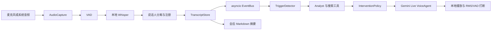

# MeetAgent 架构（Phase 1）

## 目标与边界

MeetAgent 在本机采集、保存并转写会议音频；本地 Whisper 逐字稿是会议事实记录的唯一来源。Gemini Live 提供低延迟语音交互，Analyst 使用 Gemini Flash 与搜索工具完成核查和研究。没有获得必要同意时，不启动采集或向云端发送音频。

Phase 1 只实现配置、事件类型、事件总线和 `doctor` 诊断入口。音频采集、持久化、ASR、分离、检索、策略、摘要和 Live 会话仍是后续阶段的接口。

## 数据流

## 组件职责

| 组件 | 接收 | 负责 | Phase |
|---|---|---|---|
| AudioCapture | 设备、采样率 | 麦克风/系统音频采集，后续做 AEC | 2 |
| VAD | PCM 帧 | 检测语音段，避免静音反复调用 ASR | 2 |
| ASRBackend | 语音段、语言 hint | 返回带时间戳的转写；M5 优先验证 MLX/whisper.cpp | 2 |
| DiarizationBackend | 语音段 | 为 utterance 分配 speaker id | 2 |
| TranscriptStore | utterance/event | 写 SQLite、JSONL 和可读文本 | 2 |
| EventBus | typed event | 在 asyncio 任务间传递事件 | 1 |
| TriggerDetector | utterance | 检测中/英/德唤醒词和研究/核查意图 | 3 |
| Analyst | 近期逐字稿与触发类型 | 搜索并给出带来源的核查/研究结果 | 3 |
| InterventionPolicy | finding、模式、预算 | 决定静默卡片、按请求播报或有限主动播报 | 3 |
| VoiceAgent | 文本上下文或 16 kHz Live 音频流 | 收发语音；本地 RMS/VAD 即时清空播放队列，服务端 interrupted 作同步兜底 | 4 |
| Summarizer | 完整会议时间线 | 输出不补造事项的 Markdown 纪要 | 5 |

## 实时与可打断语音

VoiceAgent 的 Live 上行和下行必须并发运行。音频采用 16 kHz 单声道 PCM 输入、24 kHz PCM 输出；输入切成约 20–40 ms 小块。客户端发现用户插话时立即清空待播 PCM，向 Live 发送实时输入；若收到 `server_content.interrupted`，再次清空所有旧回合缓存，避免过期音频续播。每个 `session.receive()` 结束后继续接收下一轮。长会话需压缩上下文，并用 session resumption 与 `goAway` 处理连接轮换。

主路径是“持续倾听、按请求回答”：会议期间持续把麦克风流送入 Live session，以获得会话上下文；Agent 默认静默，只有用户明确点名并提问（例如“Agent，你怎么看？”、“Hey Agent, what do you think?”、“Agent, was meinst du?”）才开口。无需先独立说唤醒词再问问题。播放时用户可直接插话并打断。

文本触发语音回复作为可选路径：只发送近期本地逐字稿和 Analyst 结果，不持续上传会议音频。连续音频主路径会把整场麦克风流发送至 Gemini，必须在启动前提示并取得必要同意；传输和成本在用户询问前已经持续发生。

## 事件与状态

事件由不可变 dataclass 承载，并含 UTC 时间戳、会议 id 和递增序号。`Utterance` 至少包含开始/结束时间、文本、语言、speaker id、来源和置信度。事件总线对每个订阅者维护独立队列；队列满时要报告过载，不能静默丢掉 TranscriptStore 的事实记录。Live 音频帧单独走有界队列，优先保证低延迟，超载时丢弃最旧帧并记指标。

会议生命周期：`IDLE → CONSENT → RECORDING ↔ AGENT_SPEAKING → STOPPING → FINALIZING → CLOSED`。本地录音、逐字稿落盘与云端 Live 会话是独立状态；API 断线不能中止本地转写和保存。Ctrl+C 进入 STOPPING，先停止采集并 flush 存储，再尝试摘要，最后关闭音频设备和客户端。

## 配置与诊断

配置优先级为 CLI 参数、环境变量、用户配置文件、程序默认值。API key 从 `GEMINI_API_KEY`/`GOOGLE_API_KEY` 环境变量或系统密钥存储读取，永不写入普通配置文件或日志。输出目录默认由用户显式指定，允许任意普通文件夹，也允许 Obsidian vault 路径。

`meetagent doctor` 只做诊断，不启动录音：报告 OS/架构、输入设备列表、ASR 后端/模型路径、Metal/whisper.cpp 后端、Gemini key 是否存在（不显示值）、输出目录可写性和依赖缺失。单项失败以可读建议显示；诊断汇总使用适当退出码。

## Phase 1 实现边界

当前 `doctor` 已检查 OS/架构、Gemini key 是否存在、输出目录是否可写、sounddevice 依赖、系统输入设备枚举、平台 ASR 依赖和 Apple Metal 可用性。它不会主动打开麦克风、不实际加载 Whisper 权重或执行推理，因此设备隐私授权和模型实际推理仍要在录音/ASR流程中验证。缺少云端 key 是可选云端功能提示，不影响本地诊断退出码。

## 决策记录

具体取舍见 [ADR-001](adr/ADR-001-local-asr-source-of-truth.md) 至 [ADR-009](adr/ADR-009-consent-and-audio-retention.md)。Phase 0 目前只有 M5 合成单语 ASR 性能基线和 Gemini 文本输入/语音输出连通性已测；Live 实时打断、长会话恢复、NON_BLOCKING 工具、真实会议 ASR、说话人分离与 Linux 后端仍未验收。架构不把这些假设写成实测事实。
